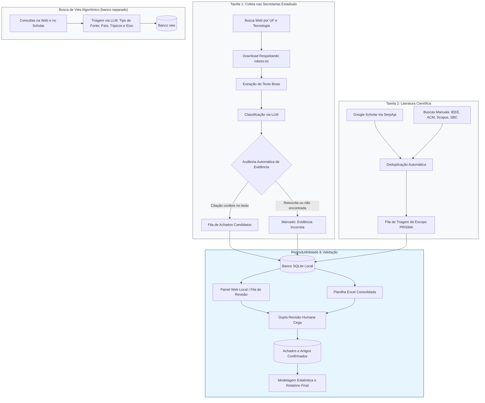
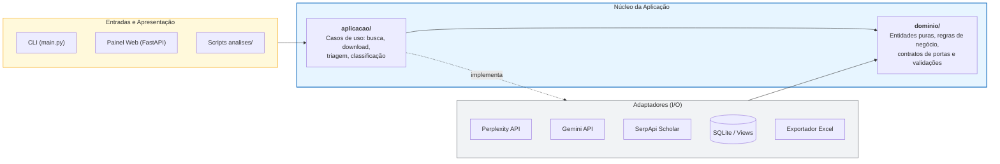

# Automação da Revisão Sistemática: IA na Segurança Pública Brasileira

<p align="left">
  
  
  
  
  
</p>

Pipeline em Python desenvolvido para apoiar a **revisão sistemática e o mapeamento do uso de Inteligência Artificial na segurança pública brasileira** (no âmbito de pesquisa para a SENASP/MJSP). O sistema combina automação de ponta a ponta com rigor metodológico em duas frentes complementares:

| Tarefa | Pergunta da Pesquisa | O que o sistema faz |
|---|---|---|
| **1. Secretarias Estaduais** | Quais UFs usam, testam, contratam ou estudam IA (reconhecimento facial, leitura de placas, videomonitoramento inteligente, análise preditiva, atendimento virtual, outras)? | Realiza buscas web parametrizadas por UF e tecnologia, efetua download respeitando `robots.txt`, extrai texto, classifica com LLM **exigindo citação textual literal**, audita a evidência no texto bruto e direciona achados para verificação humana. |
| **2. Literatura Científica** | O que a literatura acadêmica relata sobre aplicações de IA na segurança pública no Brasil? | Coleta dados no Google Scholar (via SerpApi), integra buscas manuais nas bases IEEE, ACM, Scopus e SBC OpenLib, deduplica registros e gerencia triagem em dupla cega sob o protocolo PRISMA. |

> [!NOTE]
> **Busca de viés algorítmico:** um banco separado (`--banco vies`, em `data/vies/`, `outputs/vies/` e `logs/vies/`, com login próprio) reúne a busca de literatura científica e cinzenta sobre viés algorítmico: consultas na web em português (`buscar-literatura`) e no Google Scholar, triagem por LLM com tipo de fonte, país, tópicos e eixo temático, e análises próprias no painel. Sem a opção, todos os comandos continuam usando o banco da pesquisa principal.

---

### Princípios Metodológicos

1. **Humano no Circuito (*Human-in-the-loop*):** Nenhuma saída do modelo é verdade até que um pesquisador a confirme. Painéis, exportações e relatórios separam `classificado` de `confirmado`.
2. **Rastreabilidade Estrita:** Toda chamada externa registra parâmetros de envio, resposta bruta com hash SHA-256, latência, número de tentativas e custo estimado em tokens/reais.
3. **Reprodutibilidade Científica:** Toda execução grava a configuração completa (com hash), hash de lockfile de dependências e commit exato do Git.
4. **Isolamento e Soberania dos Dados:** Suíte de testes 100% offline (fixtures pré-gravadas e dados sintéticos). O painel opera sem CDNs externas, com fontes e ícones locais.
5. **Arquitetura Desacoplada:** Provedores de busca e modelos de linguagem são adaptadores intercambiáveis por configuração.

> [!TIP]
> **Novo no projeto?** O guia detalhado (`docs/GUIA_DO_PROJETO.md`, documentação interna mantida fora do repositório) explica as convenções de código, diretórios, o significado das siglas de controle (v3, t2, M0..M9, F0..F6, D1..D55, C1..C17, T01..T46) e os termos de busca utilizados.

---

## Fluxo Metodológico do Pipeline

O diagrama abaixo ilustra como as duas frentes se integram ao núcleo de dados e à validação humana:



---

## Requisitos

* Python 3.10 ou superior
* Chaves de API (apenas para etapas de coleta real; execuções simuladas e suíte de testes rodam sem chaves)

## Instalação

```bash
# Criar e ativar o ambiente virtual
python3 -m venv .venv          # ou: uv venv .venv
source .venv/bin/activate      # Windows: .venv\Scripts\activate

# Instalar dependências
pip install -r requirements.txt   # ou: uv pip install -r requirements.txt

```

> [!NOTE]
> Para congelamento de versões e reprodutibilidade idêntica à do estudo original, utilize `requirements.lock.txt`.

## Configuração

1. Copie o arquivo `.env.example` para `.env` e defina as variáveis necessárias:

```bash
cp .env.example .env

```

| Variável | Finalidade |
| --- | --- |
| `PERPLEXITY_API_KEY` | Busca web estruturada (Perplexity Search API) |
| `SERPAPI_KEY` | Coleta automatizada no Google Scholar |
| `GEMINI_API_KEY` | Classificação de páginas e triagem de escopo (Google Gemini) |
| `LLM_API_KEY` | Provedor alternativo compatível com Chat Completions (OpenAI compatível) |
| `RESEARCHER_EMAIL` | E-mail de identificação acadêmica transmitido no `User-Agent` dos downloads |

> [!WARNING]
> O arquivo `.env` nunca deve ser versionado nem conter credenciais em repositórios públicos.

2. Parâmetros da pesquisa em `config/`:

| Arquivo | Conteúdo |
| --- | --- |
| `config/consultas.py` | Termos de busca (T01..T46), listas de UFs, perfis de download e filtros |
| `config/vocabulario.py` | Taxonomia canônica de tecnologias, status de adoção e esferas |
| `config/prompts.py` | Prompts do classificador com versionamento estrito (`PROMPT_VERSAO`) |
| `config/triagem_escopo.py` | Critérios e esquemas de resposta da triagem de literatura acadêmica |
| `config/settings.py` | Seleção dos adaptadores ativos, limites de pausa e tabela de preços de APIs |

---

## Primeiros Passos (Simulação Gratuita)

Você pode experimentar o fluxo de ponta a ponta sem chaves de API nem custos financeiros:

```bash
# 1. Executar a suíte de testes automatizados (2.200+ testes offline)
pytest -q

# 2. Estimar o custo financeiro e o total de requisições de uma rodada
python main.py estimar --simulado

# 3. Executar o pipeline de ponta a ponta em banco isolado (data/simulado.db)
python main.py tudo --simulado --ufs PI CE --paginas 1

# 4. Gerar a planilha consolidada de auditoria e métricas
python main.py exportar --simulado

```

---

## Comandos Principais da CLI

```bash
# --- Tarefa 1: Coleta Estadual ---
python main.py busca-web --ufs PI SP --limite 10           # Realiza buscas web direcionadas
python main.py baixar --de <run_id>                       # Baixa as páginas e extrai texto
python main.py classificar --de <run_id>                  # Classifica evidências com LLM
python main.py pipeline-uf --ufs PI                       # Sequência busca + download + classificação

# --- Tarefa 2: Literatura Científica ---
python main.py academico                                  # Busca no Google Scholar via SerpApi
python main.py manual-importar <planilha>                 # Importa contagens de buscas IEEE/ACM/Scopus
python main.py manual-artigos-importar <arquivo>          # Importa artigos deduplicando contra o Scholar
python main.py triar-escopo --fonte artigos --amostra 20  # Triagem preliminar de escopo via LLM

# --- Busca de Viés Algorítmico (banco vies) ---
python main.py buscar-literatura --conjunto A --limite 5 --banco vies     # Consultas na web (português, Brasil)
python main.py academico --banco vies                                     # Busca no Google Scholar no banco vies
python main.py triar-escopo --fonte referencias --amostra 20 --banco vies # Triagem das referências da web
python main.py triar-escopo --fonte artigos --amostra 20 --banco vies     # Triagem dos artigos do Scholar

# --- Gestão de Revisão Humana e Resultados ---
python main.py exportar                                   # Gera pasta outputs/ com a planilha consolidada
python main.py achados-importar <planilha.xlsx>           # Importa conferência humana dos achados
python main.py triagem-importar <planilha.xlsx>           # Importa triagem humana da literatura (PRISMA)
python main.py exportar-casos                             # Planilha "Casos Estaduais" com os achados confirmados
python main.py exportar-referencias                       # Catálogo de referências em planilha

```

### Comandos Administrativos e Utilitários

* `python main.py rotulagem-modelo`: Prepara linhas pendentes para destravar análises de concordância (H2, H5).
* `python main.py usuario-admin`: Cria ou redefine o acesso de um administrador do painel web (com `--banco vies`, no login próprio do banco vies).
* `python main.py execucao-excluir <run_id> --motivo "piloto"`: Oculta uma rodada piloto das views agregadas sem deletar dados.
* `python main.py execucao-incluir <run_id>`: Restaura a execução para as visualizações agregadas.

### Flags de Resgate Operacional

* `--so-sem-pagina`: Em `baixar`, pula URLs que já tiveram texto extraído com sucesso em execuções anteriores.
* `--so-falha MOTIVO`: Em `baixar`, tenta novamente apenas URLs com motivo específico (`http_403`, `erro_de_rede`, etc.).
* `--so-nao-classificadas`: Em `classificar`, avalia apenas páginas sem classificação com a mesma versão de prompt.
* `--auditoria N`: Sorteia uma amostra reprodutível de N links descartados pelo pré-filtro para auditar falsos negativos.
* `--retomar <run_id>`: Retoma uma execução interrompida exatamente de onde parou.
* `--banco vies`: Em qualquer comando que abre o banco, usa o banco separado da busca de viés algorítmico.

---

## Painel Web de Triagem e Auditoria

O projeto conta com interface web construída com **FastAPI, Jinja2 e Design System local** (sem CDNs externas, fontes embutidas):

```bash
# Executar painel em modo de demonstração com dados sintéticos
python main.py painel-demo
python main.py painel --demo            # Abre em http://127.0.0.1:8000 (faixa roxa)

# Executar painel conectado à base real de pesquisa (apenas conexões locais)
python main.py painel                   # Abre em http://127.0.0.1:8000 (faixa azul)
python main.py painel --banco vies      # Banco da busca de viés algorítmico (faixa verde)
python main.py painel --somente-leitura # Nenhuma decisão pode ser gravada

# Gerar relatório HTML estático (somente achados confirmados por humanos)
python main.py painel-relatorio

```

### Funcionalidades do Painel

* **Revisão Ágil com Teclado:** Na fila de revisão, navegue rapidamente com atalhos: `1` a `6` para atribuir status, `d` para descartar, `n` para pular, `u` para desfazer e `e` para focar na evidência literal no texto original.
* **Segurança e Concorrência:** Cria backups automáticos em `data/backups/` antes de sessões críticas e rejeita edições concorrentes de um mesmo registro.
* **Módulo Administrativo:** Gestão de revisores e logs de auditoria de decisões.
* **Análises:** Página em abas com os números do banco, cada título dizendo a conclusão e a memória de cálculo ao lado; no banco vies, abas próprias (ferramentas de busca, tipos de fonte, eixos e tópicos, tempo e lugar, consultas e conjuntos, sites da web) e uma legenda no fim da página.
* **Referências:** Tela com as referências da busca de viés algorítmico, página de cada referência da web com a triagem do LLM e download no formato do modelo ampliado.
* **Planilha Casos Estaduais:** Download, na tela de Achados, dos achados confirmados no formato do modelo "Casos Estaduais".

---

## Painel Local e na Nuvem

O painel roda por padrão no computador de quem pesquisa, sobre o banco SQLite local. O mesmo código também serve uma cópia do painel na nuvem, sobre PostgreSQL (`DB_BACKEND=postgres`): só o painel vai para a nuvem, enquanto a coleta, a classificação, a triagem e as chaves de API continuam no computador local. As tabelas e views do PostgreSQL são criadas por migrações versionadas (`python main.py pg-migrar`), e o painel se recusa a subir com o esquema desatualizado.

**Enviar a coleta para a nuvem:** `python main.py enviar --run <run_id>` (repita `--run` para várias) manda só os dados da coleta daquela execução, sem os arquivos brutos e sem decisões humanas, usando o endereço do painel e o token pessoal da página Minha conta (`PAINEL_NUVEM_URL` e `PAINEL_TOKEN` no `.env`). Reenviar a mesma execução só acrescenta e atualiza o que mudou.

> [!NOTE]
> Os passos de implantação na nuvem ficam em `IMPLANTACAO.md`.

---

## Análises Estatísticas Avançadas (`analises/`)

Os scripts analíticos avançados ficam isolados em `analises/`, operando em modo somente-leitura sobre o banco SQLite:

```bash
# Instalação das dependências específicas para modelagem estatística
pip install -r analises/requirements-analise.txt

# Execução das rotinas analíticas
python analises/h2_logistica.py        # Regressão logística sobre fatores de adoção de IA por UF
python analises/h5_bibliometria.py      # Análise bibliométrica e leis de dispersão da literatura
python analises/saturacao_busca.py     # Estimativa de curvas de saturação da busca
python analises/gerar_mapa_ibge.py      # Mapas coropléticos com malha vetorial oficial do IBGE

```

---

## Arquitetura do Sistema

O repositório segue o padrão de **Portas e Adaptadores (Arquitetura Hexagonal)**, garantindo que o domínio metodológico permaneça imune a alterações em APIs externas:



* **`dominio/`**: Entidades em dataclasses, contratos das portas (Protocols) e regras de validação. Não realiza E/S nem importa bibliotecas externas de rede.
* **`aplicacao/`**: Orquestra as etapas da pesquisa (busca, download, extração, deduplicação e triagem).
* **`adaptadores/`**: Implementações de provedores externos, acesso a banco e arquivos brutos. Não leem variáveis de ambiente diretamente.
* **`infra/`**: Utilitários transversais (HTTP com retry, logging padronizado e tratamento de exceções).
* **`design/`**: Sistema visual autônomo com compilador de CSS, empacotador de ícones SVG e fontes locais sem telemetria.

---

## Limitações Conhecidas

* **Google Scholar:** O total de resultados informado pelo Scholar é uma aproximação estatística; os cálculos de cobertura são referenciais.
* **Renderização Dinâmica:** Páginas que dependem de execução profunda de JavaScript ou PDFs digitalizados sem camada OCR falham na extração e são catalogadas com seu respectivo motivo no banco.
* **Checagem Literal de Evidências:** A conferência é estrita e normalizada. Se o modelo de linguagem parafrasear o trecho ao invés de transcrevê-lo literalmente, a evidência é intencionalmente sinalizada como `não confere`.
* **Política de Download:** A coleta adere à RFC 9309 (`robots.txt`), inclui identificação clara no cabeçalho HTTP e possui tempo limite (*timeout*) por requisição.

---

## Documentação Técnica Complementar

Estes documentos são internos ao projeto e não fazem parte deste repositório.

| Documento | Descrição |
| --- | --- |
| `docs/GUIA_DO_PROJETO.md` | Estrutura detalhada de diretórios, mapa de variáveis, siglas e convenções |
| `docs/ROADMAP.md` | Marcos alcançados, rodadas de coleta executadas e pendências de validação |
| `docs/METRICAS.md` | Dicionário de dados, fórmulas analíticas e métricas do funil PRISMA |
| `docs/GUIA_DO_PAINEL.md` | Manual de uso do painel web, atalhos de teclado e filtros |
| `docs/PLANO_ANALISE_DADOS.md` | Formalização metodológica das hipóteses de pesquisa e plano estatístico |
| `docs/ESTATISTICA_EXPLICADA.md` | Justificativas teóricas das técnicas estatísticas adotadas |
| `docs/termos.md` | Matriz metodológica e origem dos termos de busca |
